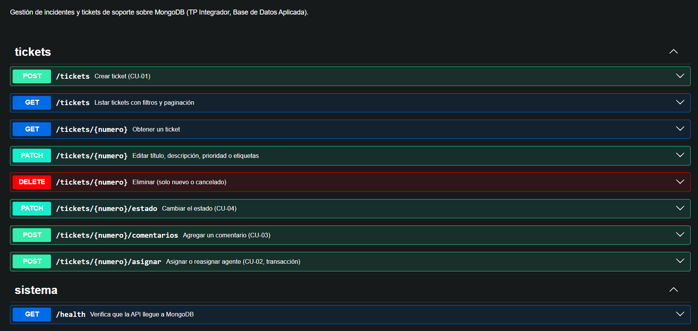
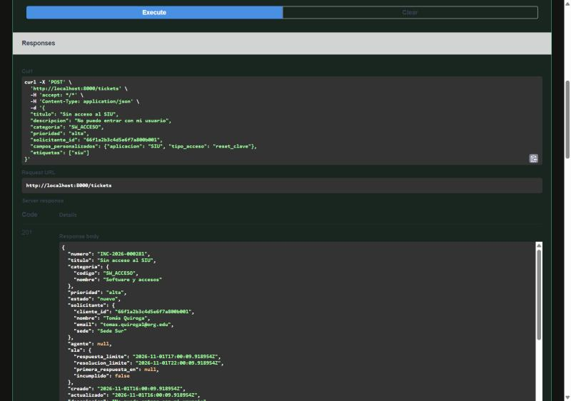
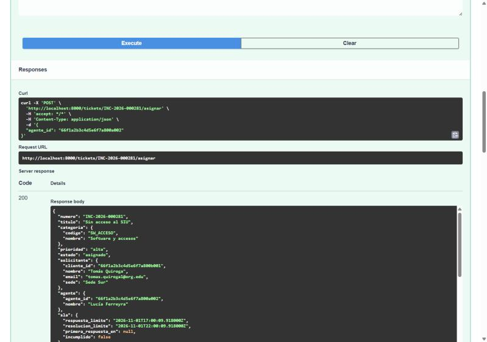
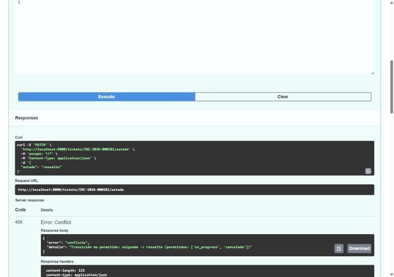

# Sentinel: API, repositorios y consistencia (Entrega Parcial 3)

**Fecha:** Noviembre 2026  
**Proyecto:** Trabajo Práctico Integrador MongoDB - Base de Datos Aplicada  
**Integrantes:** Enzo Parra, Santiago Dhers, Tomas Vogt, Santino Vazquez de Novoa  

---

## 1. Alcance de esta entrega

Según el plan de trabajo (Semana 3): operaciones CRUD sobre la entidad principal (`tickets`) expuestas mediante una API, capa de repositorios que concentra el acceso a MongoDB, validaciones y manejo de errores, e implementación y prueba del caso de consistencia. El análisis de datos en Python y la integración con Docker Compose corresponden a la entrega final.

| Requerimiento de la consigna (5.4 y 5.6) | Dónde se resuelve |
| --- | --- |
| Administrar la entidad principal mediante una API (CRUD + listado con filtros) | `api/app/routers/tickets.py` — sección 4 |
| Capa de repositorios que concentre el acceso a MongoDB | `api/app/repositories/` — sección 3 |
| Validar los datos y manejar identificadores inexistentes | `schemas/ticket.py` + servicio — sección 5 |
| Códigos HTTP y mensajes de error adecuados | `api/app/errors.py` — sección 5 |
| Separar API, lógica de negocio y acceso a datos | router → service → repository — sección 3 |
| Demostrar las operaciones con Swagger | `http://localhost:8000/docs` — sección 4 |
| Caso de consistencia: descripción, solución y prueba ante errores | transacciones en `services/tickets_service.py` — secciones 7 y 8 |

**Tecnología:** Python 3.12, FastAPI 0.162, PyMongo 4, Pydantic 2 y pytest 9, sobre MongoDB 7 configurado como *Replica Set* de un miembro (`rs0`) en un contenedor Docker. Las instrucciones completas de instalación y ejecución están en el `README.md` (secciones 1 a 9).

---

## 2. Entorno de ejecución

Las transacciones multidocumento requieren un *Replica Set*; una instancia *standalone* no las admite. El entorno se levanta con:

```bash
docker run -d --name sentinel-mongo -p 27017:27017 mongo:7 --replSet rs0
docker exec sentinel-mongo mongosh --quiet --eval "rs.initiate({_id:'rs0', members:[{_id:0, host:'localhost:27017'}]})"
pip install -r requirements.txt -r api/requirements.txt
python scripts/cargar_datos.py                                   # base "sentinel" con validadores
python -m uvicorn app.main:app --app-dir api --reload            # API en http://localhost:8000
python -m pytest api/tests -v                                    # 53 tests (usan una base descartable)
```

La configuración se lee de variables de entorno (`MONGO_URI`, `MONGO_DB`, `ANIO_NUMERACION`) con valores por defecto para el entorno local. Cuando se integre Docker Compose (entrega final), la API se conectará al servicio por su nombre (`mongodb://mongo:27017`) y no por `localhost`.

---

## 3. Arquitectura

La API está organizada en tres capas con responsabilidades separadas:

```text
HTTP ──► routers/tickets.py ──► services/tickets_service.py ──► repositories/*_repo.py ──► MongoDB
         (solo HTTP)            (reglas de negocio)              (único acceso a la base)
              ▲                          │
              └──── errors.py ◄──────────┘  (errores del dominio → códigos HTTP)
```

| Capa | Archivos | Responsabilidad | No hace |
| --- | --- | --- | --- |
| **Router** | `routers/tickets.py` | Leer parámetros y body, llamar al servicio, elegir el código de respuesta | Reglas ni consultas |
| **Servicio** | `services/tickets_service.py` | SLA, campos personalizados, transiciones, carga de agentes, transacciones | HTTP ni consultas directas |
| **Repositorios** | `repositories/tickets_repo.py`, `categorias_repo.py`, `agentes_repo.py`, `clientes_repo.py`, `contadores_repo.py` | Traducir cada operación a su consulta MongoDB | Decidir reglas de negocio |
| Soporte | `schemas/ticket.py`, `errors.py`, `db.py`, `config.py`, `main.py` | Modelos Pydantic, traducción de errores, conexión y transacciones, configuración, arranque | — |

**Repositorios.** Hay un módulo por colección y son los únicos que ejecutan `find`, `insert_one`, `update_one`, etc. Todas las funciones aceptan `session=None`: llamadas sueltas funcionan solas, y dentro de una transacción el servicio les pasa la sesión para que formen parte de ella. Ejemplo:

```python
def incrementar_carga_si_hay_cupo(agente_id, session=None) -> bool:
    r = _col().update_one(
        {"_id": ObjectId(agente_id), "activo": True,
         "$expr": {"$lt": ["$carga_actual", "$capacidad_maxima"]}},
        {"$inc": {"carga_actual": 1}},
        session=session)
    return r.modified_count == 1
```

**Identificador de los recursos.** Las rutas usan el número de ticket (`/tickets/INC-2026-000142`) en lugar del `_id` interno: es el identificador que usa el negocio (RF-02), es único gracias al índice `uq_ticket_numero` y ese mismo índice resuelve la búsqueda.

**Endpoints sincrónicos.** Los endpoints se declaran con `def` y no con `async def` porque PyMongo es bloqueante; FastAPI los ejecuta en un *thread pool* sin bloquear el servidor.

---

## 4. Endpoints

| Método | Ruta | Función | Caso de uso | Respuestas |
| --- | --- | --- | --- | --- |
| POST | `/tickets` | Crear un ticket | CU-01 / RF-01, RF-07 | 201, 422 |
| GET | `/tickets/{numero}` | Obtener un ticket con todo su contexto | RF-02 | 200, 404, 422 |
| GET | `/tickets?estado=&prioridad=&agente_id=&page=&size=` | Listar con filtros y paginación | RF-03 | 200, 422 |
| PATCH | `/tickets/{numero}` | Editar título, descripción, prioridad o etiquetas | RF-04 | 200, 404, 409, 422 |
| DELETE | `/tickets/{numero}` | Eliminar (solo `nuevo` o `cancelado`) | RF-09 | 204, 404, 409 |
| PATCH | `/tickets/{numero}/estado` | Cambiar el estado respetando las transiciones | RF-04 / CU-04 | 200, 404, 409, 422 |
| POST | `/tickets/{numero}/comentarios` | Agregar un comentario | CU-03 / RF-05 | 201, 404, 409, 422 |
| POST | `/tickets/{numero}/asignar` | Asignar o reasignar un agente (transacción) | CU-02 / RF-06 | 200, 404, 409, 422 |
| GET | `/health` | Verificar la conexión con MongoDB | — | 200, 503 |

Las cinco primeras filas cubren el CRUD de referencia de la consigna; las tres siguientes son operaciones de negocio sobre la misma entidad. El listado devuelve una versión resumida del ticket (sin comentarios, historial ni adjuntos), ordenada por fecha de creación descendente y con el total de resultados para paginar; el filtro por agente aprovecha el índice `idx_bandeja_agente`.

### Ejemplo: crear un ticket (respuesta real, recortada)

```text
POST /tickets
{
  "titulo": "Sin acceso al SIU",
  "descripcion": "No puedo entrar con mi usuario",
  "categoria": "SW_ACCESO",
  "prioridad": "media",
  "solicitante_id": "66f1a2b3c4d5e6f7a800b001",
  "campos_personalizados": { "aplicacion": "SIU", "tipo_acceso": "reset_clave" }
}

-> 201 Created
{
  "numero": "INC-2026-000281",
  "estado": "nuevo",
  "categoria": { "codigo": "SW_ACCESO", "nombre": "Software y accesos" },
  "prioridad": "media",
  "solicitante": { "cliente_id": "66f1a2b3c4d5e6f7a800b001", "nombre": "Tomás Quiroga",
                   "email": "tomas.quiroga1@org.edu", "sede": "Sede Sur" },
  "sla": { "respuesta_limite": "2026-11-01T19:47:55.163Z", "resolucion_limite": "2026-11-02T09:47:55.163Z",
           "primera_respuesta_en": null, "incumplido": false },
  "historial": [ { "fecha": "2026-11-01T15:47:55.163Z", "tipo": "estado", "de": null, "a": "nuevo" } ],
  "metricas": { "cant_comentarios": 0, "reaperturas": 0 }
}
```

La API calcula el número (siguiente valor del contador), los límites de SLA (4 h de respuesta y 18 h de resolución para `SW_ACCESO` con prioridad media), copia la referencia extendida del solicitante y registra el primer evento del historial. Ninguno de esos campos se acepta en el request.

### Demostración con Swagger

FastAPI genera la documentación interactiva en `http://localhost:8000/docs`, desde donde se ejecutan todas las operaciones. Las capturas siguientes muestran un recorrido sobre la base `sentinel`: se crea un ticket, se lo asigna y se intenta una transición que la categoría no permite.

**Endpoints disponibles:**



**Crear un ticket — `POST /tickets` → 201.** La API devuelve el ticket con el número asignado por el contador (`INC-2026-000281`), estado `nuevo`, la referencia extendida del solicitante y los límites de SLA calculados:



**Asignarlo — `POST /tickets/INC-2026-000281/asignar` → 200.** En la misma transacción el ticket pasa a `asignado` con Lucía Ferreyra y su `carga_actual` sube en 1:



**Transición no permitida — `PATCH /tickets/INC-2026-000281/estado` con `resuelto` → 409.** Desde `asignado` la categoría solo permite pasar a `en_progreso` o `cancelado`:



---

## 5. Validaciones y manejo de errores

La validación se hace en dos niveles:

1. **Formato** (modelos Pydantic de `schemas/ticket.py`): tipos, campos obligatorios, valores permitidos de `prioridad` y `estado`, formato de ObjectId en los ids, longitud del título, formato `INC-AAAA-NNNNNN` del número en la ruta, rango de `page` y `size`. Los campos desconocidos se rechazan (por ejemplo, enviar `"estado"` al crear). FastAPI responde 422 automáticamente.
2. **Reglas de negocio** (servicio): lo que depende de la base de datos — que la categoría y el cliente existan, que los `campos_personalizados` cumplan la definición de la categoría, que la transición esté permitida, que el agente tenga cupo.

Los campos personalizados se validan contra `categorias.campos_personalizados`: presencia de los obligatorios (con claves anidadas como `equipo.inventario`), tipo (`string`, `int`, `double`, `bool`) y opciones de los `enum`. Se admiten claves adicionales, porque el documento del ticket es polimórfico por diseño.

El servicio no conoce HTTP: lanza errores del dominio y `errors.py` los traduce con un formato uniforme `{"error": "<codigo>", "detalle": "<mensaje>"}`:

| Error | HTTP | Cuándo |
| --- | --- | --- |
| `NoEncontrado` | 404 | El ticket no existe |
| `Conflicto` | 409 | Transición no permitida, agente sin cupo o inactivo, borrar un ticket abierto, editar un ticket cerrado, el ticket cambió durante la operación |
| `Validacion` | 422 | Campos personalizados inválidos, categoría, cliente o agente inexistente |
| `DuplicateKeyError` (PyMongo) | 409 | Respaldo de los índices únicos (número de ticket, emails) |
| `ServerSelectionTimeoutError` (PyMongo) | 503 | MongoDB no responde |

### Ejemplos reales de respuestas de error

```text
POST /tickets   (campos_personalizados: { "tipo_acceso": "borrar_todo" })
-> 422  {"error": "validacion", "detalle": "Campos personalizados inválidos para SW_ACCESO: falta 'aplicacion' (obligatorio); 'tipo_acceso' debe ser uno de ['alta', 'baja', 'reset_clave', 'permiso']"}

PATCH /tickets/INC-2026-000281/estado   {"estado": "resuelto"}
-> 409  {"error": "conflicto", "detalle": "Transición no permitida: nuevo -> resuelto (permitidas: ['asignado', 'cancelado'])"}

POST /tickets/INC-2026-000281/asignar   {"agente_id": "66f1a2b3c4d5e6f7a800a005"}
-> 409  {"error": "conflicto", "detalle": "Javier Rossi alcanzó su capacidad máxima (4)"}

DELETE /tickets/INC-2026-000281   (ticket en estado asignado)
-> 409  {"error": "conflicto", "detalle": "Solo se pueden borrar tickets en ['nuevo', 'cancelado']; INC-2026-000281 está asignado. Cancelalo primero."}

GET /tickets/INC-2026-999999
-> 404  {"error": "no_encontrado", "detalle": "No existe el ticket INC-2026-999999"}
```

---

## 6. Reglas de negocio implementadas

| Operación | Reglas |
| --- | --- |
| **Crear** (CU-01) | Categoría existente y activa; campos personalizados válidos; solicitante existente; numeración atómica con `contadores`; SLA = creación + minutos de la categoría según prioridad (RF-07); estado inicial `nuevo`. |
| **Editar** (RF-04) | No se editan tickets `cerrado` ni `cancelado`. Cambiar la prioridad recalcula los límites de SLA desde la creación y registra un evento `prioridad` en el historial. |
| **Cambiar estado** (RF-04, CU-04) | Solo las transiciones que define la categoría para el estado actual. A `asignado` solo se llega por `/asignar` (necesita un agente). Al resolver se guarda `resuelto_en` y si se incumplió el SLA. Reabrir (`resuelto → en_progreso`) incrementa `metricas.reaperturas`. |
| **Comentar** (CU-03, RF-05) | No se comenta en tickets finalizados. El primer comentario de un agente registra `sla.primera_respuesta_en`. |
| **Asignar / reasignar** (CU-02, RF-06) | Agente existente y activo. Si el ticket está `nuevo` se asigna; si está abierto se reasigna a otro agente. Siempre en transacción (sección 7). |
| **Eliminar** (RF-09) | Solo tickets `nuevo` o `cancelado`; el resto debe cancelarse, no borrarse. |

---

## 7. Consistencia y transacciones

### Caso de negocio

`carga_actual` de cada agente es un **valor calculado**: la cantidad de tickets suyos en estado `asignado`, `en_progreso` o `en_espera`. Se mantiene con `$inc` para no tener que contar tickets en cada asignación. Asignar un ticket (CU-02) modifica **dos documentos en dos colecciones**:

1. En `tickets`: el subdocumento `agente`, el `estado` (`nuevo → asignado`) y un evento en `historial`.
2. En `agentes`: `carga_actual + 1`, siempre que no supere `capacidad_maxima`.

**Qué ocurre si una parte se completa y la otra falla:**

* Si se actualiza el ticket y falla el agente, el técnico tiene trabajo que no se refleja en su carga; las asignaciones siguientes pueden superar su capacidad.
* Si se incrementa la carga y falla el ticket, el agente queda con un cupo ocupado por un ticket que no tiene.

En ambos casos la base queda inconsistente sin que ningún error lo indique después (el test D lo demuestra, sección 8).

### Solución: transacción multidocumento

El servicio ejecuta las dos escrituras dentro de `session.with_transaction(...)` (`db.en_transaccion`, con `readConcern: snapshot` y `writeConcern: majority`). Si cualquier paso falla, se lanza una excepción, la transacción se aborta y ninguna de las dos escrituras queda aplicada. `with_transaction` además reintenta automáticamente ante errores transitorios (por ejemplo, conflictos de escritura entre transacciones concurrentes).

```python
def operacion(session):
    actualizado = tickets_repo.asignar_agente(numero, agente_ref, campos, evento, session=session)
    if actualizado is None:
        raise Conflicto("El ticket cambió mientras se procesaba el pedido; reintentá")
    if not agentes_repo.incrementar_carga_si_hay_cupo(agente["_id"], session=session):
        raise Conflicto(f"{agente['nombre']} alcanzó su capacidad máxima")
    if anterior:                                   # reasignación: libera al agente anterior
        agentes_repo.decrementar_carga(anterior["agente_id"], session=session)
    return actualizado

return en_transaccion(operacion)
```

Respecto de la entrega 2 (donde solo se probó la asignación en mongosh), el mismo mecanismo se aplica a **todas** las operaciones que hacen entrar o salir un ticket de los estados abiertos:

| Operación | Cambio en la carga | Mecanismo |
| --- | --- | --- |
| Asignar (`nuevo → asignado`) | +1 al agente (con control de cupo) | Transacción |
| Reasignar (ticket abierto, otro agente) | +1 al nuevo (con control de cupo), −1 al anterior | Transacción (tres documentos) |
| Resolver o cancelar un ticket abierto (CU-04) | −1 al agente | Transacción |
| Reabrir (`resuelto → en_progreso`) | +1 al agente (con control de cupo) | Transacción |
| Cambios dentro de los abiertos (`asignado → en_progreso`, `en_progreso ↔ en_espera`), cerrar un resuelto, cancelar un `nuevo` | ninguno | Un solo update atómico, sin transacción |

El servicio calcula el cambio de carga de forma genérica (+1 si el ticket entra a los abiertos, −1 si sale, 0 si no) y solo abre una transacción cuando es distinto de cero.

### Operaciones atómicas sin transacción

No todo requiere transacción. Cuando el diseño permite resolver la consistencia en **un solo documento**, alcanza con una operación atómica:

* **Comentar** (CU-03): `$push` del comentario, `$inc` de `metricas.cant_comentarios` y `$set` de fechas en el mismo update. El contador y el arreglo no pueden desfasarse.
* **Numeración**: `find_one_and_update` con `$inc` sobre `contadores` devuelve el siguiente número de forma atómica; dos tickets creados a la vez no reciben el mismo número. Si no existe el contador del año, se crea (`upsert`).

### Control de concurrencia

Además de la atomicidad, la API evita que dos pedidos simultáneos dejen un resultado incorrecto:

* **Control de cupo en el filtro del update.** La condición `$expr: {$lt: ["$carga_actual", "$capacidad_maxima"]}` se evalúa en la misma operación que el `$inc`. Si se hiciera "leer la carga, comparar en Python y después incrementar", dos asignaciones simultáneas podrían leer 3/4, ver lugar las dos y terminar en 5/4.
* **Estado esperado en el filtro.** Las escrituras sobre el ticket filtran por el estado que el servicio leyó (por ejemplo `{numero, estado: "nuevo"}` al asignar). Si otro pedido lo modificó entre la lectura y la escritura, el filtro no coincide, el repositorio devuelve `None` y el servicio responde 409 en lugar de pisar el cambio.

---

## 8. Pruebas automatizadas

Las pruebas están en `api/tests/` y se ejecutan con `python -m pytest api/tests -v`. Usan el `TestClient` de FastAPI, que hace requests a la API sin levantar el servidor.

**Base de datos descartable.** Los tests no usan la base `sentinel`: `conftest.py` fija `MONGO_DB=sentinel_test` antes de importar la API y:

1. Al empezar crea `sentinel_test` en el mismo servidor, desde `data/*.json`, con los mismos validadores `$jsonSchema` que `cargar_datos.py` y los mismos índices que `indices.js`.
2. Antes de **cada** test vacía las colecciones y reinserta los datos originales, así cada test es independiente.
3. Al terminar borra `sentinel_test`.

Si MongoDB no responde o no es un *Replica Set*, la ejecución se detiene con un mensaje explicativo. Esto permite que cualquier integrante corra las pruebas sin preparar datos ni modificar su base.

### `test_crud.py` (38 tests)

Crear (numeración consecutiva, SLA calculado, referencia extendida; campos personalizados con obligatorio faltante, enum inválido y tipo incorrecto; categoría y cliente inexistentes; campos extra o con formato inválido, verificando que no se guarde nada), obtener (existente, 404, número mal formado), listar (filtros por estado, agente y prioridad comparados contra conteos directos en la base; paginación sin repetidos; parámetros inválidos), editar (campos no enviados sin cambios, recálculo de SLA, tickets cerrados), comentar (solo el primer comentario de un agente registra la primera respuesta), transiciones permitidas y no permitidas, y eliminar (permitido, 409 y 404).

### `test_consistencia.py` (15 tests)

Al final de cada escenario se verifica que la `carga_actual` de **todos** los agentes coincida con la cantidad real de tickets abiertos que tienen.

| Test | Comportamiento verificado |
| --- | --- |
| **A.** Asignación correcta | 200; el ticket queda `asignado` con el agente y el evento en el historial; la carga sube exactamente 1. |
| **B.** Falla entre las dos escrituras | Se reemplaza la función que incrementa la carga por una que lanza un error, **después** de que el ticket ya fue modificado dentro de la transacción. El ticket vuelve a `nuevo`, sin agente ni evento nuevo, y la carga no cambia: **rollback**. |
| **C.** Agente sin cupo | Se completa la capacidad del agente con asignaciones reales; la siguiente responde 409 y no deja cambios. |
| **D.** Sin transacción | Las mismas dos escrituras sin transacción, cortadas a mitad de camino: el ticket queda `asignado` pero la carga no sube. La verificación de consistencia **falla**, demostrando el problema que resuelve la transacción. |
| Agente inactivo / inexistente | 409 / 422, sin cambios. |
| Ticket cerrado | No se puede asignar (409). |
| Reasignar | La carga del agente anterior baja 1 y la del nuevo sube 1; el historial registra la reasignación. |
| Reasignar a un agente sin cupo | 409; el ticket conserva su agente y ninguna carga cambia. |
| Reasignar al mismo agente | 409. |
| Ciclo de vida completo | asignar → en_progreso → en_espera → en_progreso → resuelto → reabrir → cancelado, verificando la carga en cada paso (CU-04). |
| Cancelar un ticket `nuevo` | Ninguna carga cambia. |
| Reabrir sin cupo | 409; el ticket sigue `resuelto` y sin reapertura registrada (rollback). |
| **Concurrencia:** 10 asignaciones por el último cupo | 10 hilos asignan 10 tickets distintos al mismo agente con un solo cupo libre: exactamente 1 tiene éxito, la carga queda en la capacidad máxima y los otros 9 tickets siguen `nuevo`. |
| **Concurrencia:** 5 pedidos para el mismo ticket | 5 hilos intentan asignar el mismo ticket a la vez (doble click, dos supervisores): se asigna una sola vez y la carga sube una sola vez. |

Las pruebas de concurrencia cubren la extensión opcional "pruebas de concurrencia sobre una operación de negocio" de la consigna. La suite completa se ejecutó tres veces consecutivas con el mismo resultado.

### Evidencia de ejecución (`python -m pytest api/tests -v`)

```text
============================= test session starts =============================
platform win32 -- Python 3.12.0, pytest-9.2.0, pluggy-1.7.0
rootdir: ...\practico3-BDA\api
configfile: pytest.ini
collected 53 items

api\tests\test_consistencia.py::test_A_asignacion_correcta PASSED
api\tests\test_consistencia.py::test_B_falla_entre_las_dos_escrituras_hace_rollback PASSED
api\tests\test_consistencia.py::test_C_agente_sin_cupo PASSED
api\tests\test_consistencia.py::test_D_sin_transaccion_la_base_queda_inconsistente PASSED
api\tests\test_consistencia.py::test_agente_inactivo PASSED
api\tests\test_consistencia.py::test_agente_inexistente PASSED
api\tests\test_consistencia.py::test_no_se_asigna_un_ticket_cerrado PASSED
api\tests\test_consistencia.py::test_reasignar_mueve_la_carga PASSED
api\tests\test_consistencia.py::test_reasignar_a_agente_sin_cupo_no_cambia_nada PASSED
api\tests\test_consistencia.py::test_reasignar_al_mismo_agente PASSED
api\tests\test_consistencia.py::test_ciclo_de_vida_ajusta_la_carga PASSED
api\tests\test_consistencia.py::test_cancelar_un_ticket_nuevo_no_toca_cargas PASSED
api\tests\test_consistencia.py::test_reabrir_sin_cupo_se_rechaza PASSED
api\tests\test_consistencia.py::test_concurrencia_10_asignaciones_por_el_ultimo_cupo PASSED
api\tests\test_consistencia.py::test_concurrencia_5_pedidos_para_asignar_el_mismo_ticket PASSED
api\tests\test_crud.py::test_crear_ticket PASSED
api\tests\test_crud.py::test_numeracion_consecutiva PASSED
api\tests\test_crud.py::test_crear_con_campos_personalizados_invalidos[obligatorio_faltante] PASSED
api\tests\test_crud.py::test_crear_con_campos_personalizados_invalidos[enum_invalido] PASSED
api\tests\test_crud.py::test_crear_con_campos_personalizados_invalidos[tipo_incorrecto] PASSED
api\tests\test_crud.py::test_crear_red_con_vlan_como_texto PASSED
api\tests\test_crud.py::test_crear_con_referencias_inexistentes[categoria_inexistente] PASSED
api\tests\test_crud.py::test_crear_con_referencias_inexistentes[cliente_inexistente] PASSED
api\tests\test_crud.py::test_crear_con_formato_invalido[campo_extra_estado] PASSED
api\tests\test_crud.py::test_crear_con_formato_invalido[prioridad_invalida] PASSED
api\tests\test_crud.py::test_crear_con_formato_invalido[id_no_objectid] PASSED
api\tests\test_crud.py::test_crear_con_formato_invalido[titulo_corto] PASSED
api\tests\test_crud.py::test_obtener_ticket PASSED
api\tests\test_crud.py::test_obtener_inexistente PASSED
api\tests\test_crud.py::test_obtener_con_numero_mal_formado PASSED
api\tests\test_crud.py::test_listar_por_estado PASSED
api\tests\test_crud.py::test_listar_por_agente_y_prioridad PASSED
api\tests\test_crud.py::test_listar_paginado PASSED
api\tests\test_crud.py::test_listar_con_filtros_invalidos[estado_invalido] PASSED
api\tests\test_crud.py::test_listar_con_filtros_invalidos[size_mayor_a_100] PASSED
api\tests\test_crud.py::test_listar_con_filtros_invalidos[page_0] PASSED
api\tests\test_crud.py::test_listar_con_filtros_invalidos[agente_id_invalido] PASSED
api\tests\test_crud.py::test_editar_titulo_y_etiquetas PASSED
api\tests\test_crud.py::test_cambiar_prioridad_recalcula_sla PASSED
api\tests\test_crud.py::test_editar_sin_campos PASSED
api\tests\test_crud.py::test_editar_inexistente PASSED
api\tests\test_crud.py::test_no_se_edita_ni_comenta_un_ticket_cerrado PASSED
api\tests\test_crud.py::test_comentario_de_agente_registra_primera_respuesta PASSED
api\tests\test_crud.py::test_comentario_de_solicitante_no_es_primera_respuesta PASSED
api\tests\test_crud.py::test_comentario_en_ticket_inexistente PASSED
api\tests\test_crud.py::test_transicion_no_permitida PASSED
api\tests\test_crud.py::test_a_asignado_solo_por_asignar PASSED
api\tests\test_crud.py::test_resolver_registra_fecha_e_incumplimiento PASSED
api\tests\test_crud.py::test_cerrado_es_final PASSED
api\tests\test_crud.py::test_eliminar_ticket_nuevo PASSED
api\tests\test_crud.py::test_eliminar_ticket_cancelado PASSED
api\tests\test_crud.py::test_no_se_elimina_un_ticket_abierto PASSED
api\tests\test_crud.py::test_eliminar_inexistente PASSED

============================= 53 passed in 13.96s =============================
```

---

## 9. Decisiones y limitaciones

* **Huecos en la numeración.** El número se obtiene del contador antes de insertar el ticket. Si la inserción fallara, ese número quedaría sin usar. Se acepta: la garantía importante es que no se repita, no que sea continua. Incluir el contador en una transacción con la inserción serializaría todas las altas sobre un mismo documento.
* **Referencia extendida desactualizable.** El ticket copia `nombre`, `email` y `sede` del solicitante para mostrarse sin `$lookup`. Si un cliente cambia su email, los tickets anteriores conservan el anterior, lo que además es razonable como registro histórico del momento del reporte.
* **Lecturas fuera de la transacción.** El servicio lee el ticket y el agente antes de abrir la transacción, para validar y armar los mensajes de error. La corrección no depende de esa lectura: las escrituras repiten las condiciones en sus filtros (estado esperado, cupo), por lo que un cambio concurrente produce un 409 y no un dato incorrecto.
* **Replica Set de un miembro.** Habilita las transacciones pero no ofrece tolerancia a fallos; en producción se usarían al menos tres miembros.
* **Alcance.** No se implementó la administración de categorías por API (RF-08); se gestionan con los scripts de carga. La búsqueda por `_id` mencionada en RF-02 se reemplazó por el número de ticket (sección 3). La autenticación está fuera del alcance de la consigna.

---

## 10. Correcciones sobre la entrega 2

* **`consultas/consistencia.js`:** la limpieza final restaba siempre 1 a la carga de Lucía (`$inc: -1`), suponiendo que el escenario A había terminado bien; eso desfasaba la carga si A no se completaba. Ahora se guarda `cargaOriginalLucia` antes del escenario A y al final se restaura con `$set`. Se volvió a ejecutar sobre una base recién cargada: todas las verificaciones pasan y la consulta Q10 muestra a Lucía Ferreyra con 4/10 = **40 %** de ocupación (la evidencia anterior mostraba 30 %).
  La salida de Q10 en `Entrega_parcial_2.md` se reemplazó por la nueva.
* **Q3:** los datos no contienen tickets en estado `nuevo`, por lo que la rama `agente: { $exists: false }` del `$or` no tiene coincidencias (los 12 resultados salen por `sla.incumplido`). Se optó por aclararlo en `Entrega_parcial_2.md` en lugar de regenerar los datos, para no invalidar el resto de la evidencia. Se verificó que la rama funciona: un ticket crítico creado con `POST /tickets` hace que Q3 devuelva 13 resultados, y vuelve a 12 al asignarlo.
* **Q11:** el título decía "satisfacción por agente y por habilidad", pero la consulta agrupa solo por agente (y muestra su nivel y sede). Se corrigió a "satisfacción por agente (con su nivel y sede)" en `consultas.js` y en `Entrega_parcial_2.md`.
* **Numeración del caso de uso:** la entrega 2 denomina "CU-05" a la asignación; según la entrega 1 corresponde a **CU-02** (Asignar/Reasignar).